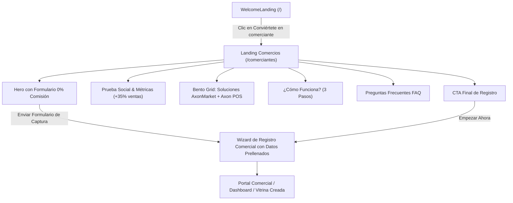

# Plan de Implementación: Landing Page para Comercios Estilo DoorDash (AxonMarket)

## 1. Visión y Objetivo

El objetivo es crear una **página de aterrizaje (Landing Page) dedicada exclusivamente a captar y convertir comerciantes** en la ruta pública `/comerciantes` (con alias `/merchants` y `/negocios`), inspirada visual y estructuralmente en la plataforma oficial de **DoorDash for Merchants** ([merchants.doordash.com](https://merchants.doordash.com/en-us?utm_source=cx_home)).

Actualmente, el botón de la segunda tarjeta en la página de bienvenida (*"Conviértete en comerciante"*) abre directamente el modal básico de registro. Con esta nueva página, el comerciante encontrará una propuesta de valor integral y persuasiva que explica todo el ecosistema de **AxonMarket**:
1. **Marketplace & Vitrina Digital**: Alcance a miles de clientes locales y ventas por delivery o pickup.
2. **Axon POS**: Punto de venta para el local físico con sincronización de inventario en tiempo real con la tienda online.
3. **Red de Repartidores**: Entregas rápidas con conductores independientes o flota propia.
4. **Menú QR & Pedidos Pickup**: Digitalización del salón y barra.
5. **Oferta de Bienvenida 1:1 de DoorDash**: *"Prueba AxonMarket con 0% de comisión durante tus primeros 30 días"*.

---

## 2. Diagrama de Arquitectura y Flujo

---

## 3. Estructura de Secciones (Ingeniería Inversa 1:1 de DoorDash)

### Secc. 1: Navbar Especializado para Comercios
- **Logo oficial de AxonMarket** acompañado de la insignia sobria `para Comercios`.
- **Menú de navegación**:
  - *Soluciones* (Marketplace, Axon POS, Delivery, Menú QR)
  - *¿Cómo funciona?*
  - *Precios & 0% Comisión*
  - *Preguntas Frecuentes*
- **Acciones**:
  - Enlace *"Iniciar sesión"* (lleva al login de comerciantes o `/storefront`).
  - Botón píldora naranja *"Empezar"* (scroll directo al formulario del Hero).

### Secc. 2: Hero Section (DoorDash 1:1 con Formulario de 0% Comisión)
- **Fondo**: Beige cálido minimalista (`#FAF7F2` / `#FCF9F6`), idéntico al lienzo editorial de DoorDash.
- **Columna Izquierda**:
  - Tag superior: `IMPULSA TU NEGOCIO CON AXONMARKET`.
  - Gran titular negro condensado:
    > **LLEGA A MILES DE CLIENTES EN TU CIUDAD**
  - Subtitular persuasivo destacando el incremento de pedidos y la sincronización con el punto de venta.
  - **Tarjeta Blanca de Captura de Prospectos (Lead Generation)**:
    - Encabezado destacado: **PRUEBA AXONMARKET CON 0% DE COMISIÓN HASTA POR 30 DÍAS**.
    - Campo 1: `Nombre de tu negocio o tienda`.
    - Campo 2: `Dirección del local comercial` (con icono de ubicación).
    - Campo 3 & 4 (Grid 2 columnas): `Correo electrónico` | `Teléfono de contacto / WhatsApp`.
    - Campo 5: `Tipo de comercio` (Selector: *Restaurante / Comida rápida, Bodegón / Víveres, Supermercado, Farmacia, Ropa / Calzado, Panadería / Repostería, Tecnología*).
    - Texto legal de consentimiento: *"Al hacer clic en 'Empezar con 0% de comisión', aceptas comenzar tu prueba sin comisiones y recibir contacto de activación."*
    - **Botón cápsula naranja oficial**: **"Empezar con 0% de comisión"** (al hacer clic, pasa los datos ingresados al asistente de registro).
- **Columna Derecha**:
  - Fotografía con corte curvo estilizado de comerciantes felices atendiendo clientes, operando el punto de venta Axon POS y empaquetando pedidos para delivery.

### Secc. 3: Franja de Confianza y Métricas de Crecimiento
- Título: *"Únete a los comercios que ya están transformando sus ventas con AxonMarket y Axon POS"*.
- 4 Tarjetas de Métricas:
  1. **+35%**: Aumento promedio en el alcance y captación de nuevos clientes en la zona.
  2. **0%**: Comisión sobre tus ventas durante los primeros 30 días de prueba.
  3. **100%**: Sincronización en tiempo real entre tu tienda física (Axon POS) y tu vitrina web.
  4. **< 5 min**: Tiempo récord de activación para publicar tus primeros productos.

### Secc. 4: Bento Grid de Soluciones del Ecosistema (Marketplace + POS + Delivery)
1. **Axon Marketplace & Vitrina Digital (Descubrimiento y Ventas)**
   - Tu tienda abierta las 24 horas del día.
   - Catálogo interactivo para móviles con fotos, variantes, precios en divisas y bolívares.
   - Enlace directo personalizado para tu bio de Instagram y WhatsApp.
2. **Axon POS Cloud & Desktop (Punto de Venta Omnicanal)**
   - Facturación rápida, control de caja multimoneda (USD / Bs) y ticket de venta.
   - **Sincronización Inteligente**: Si vendes un producto en el mostrador de tu local físico, el stock se descuenta automáticamente en tu catálogo web en tiempo real.
3. **Red de Entregas & Logística de Delivery**
   - Asignación automática de pedidos a la red de repartidores de AxonMarket con rastreo en vivo.
   - Opción para usar tus propios repartidores si ya cuentas con equipo de despacho.
4. **Menú Digital QR & Pedidos Pickup**
   - Códigos QR inteligentes para mesas y barra: tus clientes escanean, ven fotos reales del menú y pagan sin esperar la cuenta.

### Secc. 5: ¿Cómo Funciona? (3 Pasos Rápidos)
1. **Regístrate y personaliza tu marca**: Carga tu logo, dirección, horarios y métodos de pago aceptados (Pago Móvil, Zelle, Punto, Efectivo).
2. **Sincroniza o carga tu catálogo**: Agrega tus productos manualmente o conecta tu base de datos de Axon POS con 1 solo clic.
3. **Recibe pedidos y aumenta tus ganancias**: Gestiona los pedidos entrantes desde tu pantalla de preparación y entrega a domicilio o en mostrador.

### Secc. 6: Calculadora / Comparativa de Beneficios
- Comparación clara entre vender solo por WhatsApp (respuestas lentas, fotos pesadas, descontrol de inventario) vs. **Vender con AxonMarket + Axon POS** (catálogo automático, pedidos listos para despachar, cobro verificado e inventario centralizado).

### Secc. 7: Preguntas Frecuentes para Comerciantes (FAQ Accordion)
- ¿Cuánto cuesta estar en AxonMarket después de los 30 días gratis?
- ¿Necesito tener computadora o puedo operarlo desde mi teléfono?
- ¿Cómo se sincroniza el inventario con Axon POS?
- ¿Cómo recibo el dinero de mis ventas? (Pago directo a tus cuentas bancarias, sin intermediarios retenedores).
- ¿Quién realiza las entregas a domicilio?

### Secc. 8: Banner Final de Llamado a la Acción (CTA)
- Fondo oscuro elegante con acentos naranja y dorado.
- Titular: *"Comienza a vender más hoy mismo con 0% de comisión"*.
- Botón: *"Registrar mi comercio ahora"*.

---

## 4. Plan de Ejecución Paso a Paso

| Fase | Tarea | Detalle Técnico |
|---|---|---|
| **Fase 1** | Creación del componente `MerchantLandingPage.jsx` | Implementar en `src/modules/ecommerce/pages/MerchantLandingPage.jsx` el layout completo con Tailwind, el Navbar comercial y el Hero con formulario 1:1. |
| **Fase 2** | Conexión del formulario con el Wizard de Registro | Al hacer clic en *"Empezar con 0% de comisión"*, almacenar los datos capturados y disparar el asistente de registro comercial prellenado. |
| **Fase 3** | Desarrollo de las secciones de soluciones y Bento Grid | Diseñar las tarjetas interactivas de AxonMarket, Axon POS, Delivery y Menú QR. |
| **Fase 4** | Configuración de Rutas en `EcommerceRouter.jsx` | Registrar las rutas `/comerciantes`, `/merchants` y `/negocios` apuntando a `MerchantLandingPage`. |
| **Fase 5** | Enlace desde `WelcomeLanding.jsx` | Modificar el botón de la Card 2 (*"Conviértete en comerciante"*) para que navegue directamente a `/comerciantes`. |
| **Fase 6** | Verificación visual y despliegue | Validar con `browser_subagent` en escritorio y móvil, compilar con `npm run build` y desplegar en Cloudflare Pages. |
