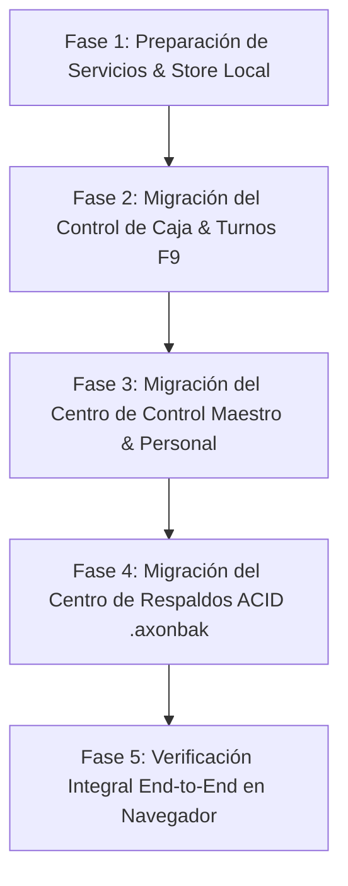

# 📋 Plan de Implementación: Migración de Lógica Crítica AxonPOS ➔ AxonMarket
**Unificación de Centro de Control Maestro, Respaldos ACID (.axonbak) y Gestión de Caja & Turnos**  
* **Versión:** 1.0 — Documento de Arquitectura y Guía Paso a Paso  
* **Objetivo:** Trasladar la lógica ya construida y probada en AxonPOS hacia AxonMarket sin reinventar la rueda, adaptándola al diseño Commercy White & Orange Suite (`#ea580c`).

---

## 🎯 1. Resumen Ejecutivo de la Migración

AxonPOS ya cuenta con módulos de nivel empresarial completamente funcionales en `f:\AxonPos\src\`:
1. **Centro de Control Maestro: Personal & Cajas Registradoras** (`UserManagementModal.tsx`)
2. **Centro de Respaldos & Disaster Recovery Motor ACID v4.0** (`BackupManagerModal.tsx`)
3. **Control de Caja, Turnos & Cuadre Ciego Multi-Moneda** (`CashShiftModal.tsx`)

La meta es incorporar esta lógica directamente en **AxonMarket** (`f:\AxonPos\Presupuesto\src\modules\ecommerce\`), conectándola con la base de datos Dexie/Supabase y habilitando sus accesos en la interfaz (Rutas `/shifts`, `/support`, atajos en `/pos` y menú móvil **Más**).

---

## 🏛️ 2. Módulos a Migrar y su Correspondencia

| Módulo en AxonPOS | Archivo Origen (AxonPOS) | Destino en AxonMarket | Punto de Entrada en UI |
| :--- | :--- | :--- | :--- |
| **Control Maestro & Personal** | `src/components/UserManagementModal.tsx` `src/components/ChangeMasterPinModal.tsx` `src/services/authService.ts` | `src/modules/ecommerce/components/admin/UserManagementModal.jsx` `src/modules/ecommerce/services/authService.js` | Ruta `/support` (Equipo), Botón en `/pos`, Menú **Más** |
| **Centro de Respaldos & Disaster Recovery** | `src/components/BackupManagerModal.tsx` `src/services/backupService.ts` `src/services/syncService.ts` | `src/modules/ecommerce/components/admin/BackupManagerModal.jsx` `src/modules/ecommerce/services/backupService.js` | Ruta `/store-profile`, Atajo en `/pos`, Menú **Más** |
| **Control de Caja & Turnos (F9)** | `src/components/CashShiftModal.tsx` `src/services/hardware/fiscalPrinterService.ts` `src/services/currencyService.ts` | `src/modules/ecommerce/components/admin/CashShiftModal.jsx` `src/modules/ecommerce/pages/UnifiedPosPage.jsx` | Ruta `/shifts`, Tecla `F9` en `/pos`, Menú **Más** |

---

## 🧩 3. Detalle Técnico Módulo por Módulo

### 3.1. Módulo 1: Centro de Control Maestro (Personal, PINes y Cajas)
* **Imagen de Referencia:** Imagen 1 proporcionada por el usuario.
* **Componente Origen:** `f:\AxonPos\src\components\UserManagementModal.tsx` (~3,327 líneas).
* **Capacidades Funcionales a Mantener:**
  1. **Autenticación por PIN Maestro Propietario (`👑 Axon (Propietario)`):**
     - PIN seguro cifrado/hasheado con modal de cambio de PIN maestro (`ChangeMasterPinModal.tsx`).
     - Autorización de sesión requerida para realizar modificaciones críticas.
  2. **Pestaña 1: Personal & PINes:**
     - Alta, edición y desactivación de empleados (Cajeros, Empacadores, Supervisores, Administradores).
     - PIN táctil de 4 dígitos para cada usuario (con toggle de visibilidad `Eye`/`EyeOff`).
     - Selector de avatar con paleta de colores predefinida.
     - **Checklist granular de 21 permisos** agrupados por categoría:
       - *Ventas & Mostrador (POS)*: Aplicar descuentos, anular ítems, cobrar libre, reimprimir tickets.
       - *Caja & Dinero*: Abrir gaveta, registrar entradas/salidas, arqueo ciego, cierre Z.
       - *Inventario & Precios*: Modificar existencias, editar precios, registrar mercadería.
       - *Configuración*: Modificar tasa BCV, backup, gestionar personal.
  3. **Pestaña 2: Cajas Registradoras:**
     - Registro y configuración de terminales: `Caja 1 - Principal`, `Caja 2 - Rápida`, `Caja 3 - Pasillo`, `Caja Barra / Gastro`, `Caja Terraza`.
     - Asignación de impresoras térmicas, balanzas y vinculación de caja a usuario activo.
  4. **Pestaña 3: Libro de Auditoría (Audit Log Inmutable):**
     - Registro cronológico de acciones: quién inició turno, quién modificó un precio, quién borró una venta o retiró dinero de caja chica.
* **Adaptación para AxonMarket:**
  - Convertir tipos TypeScript a PropTypes / JSDoc limpio para compatibilidad con Vite React.
  - Asegurar la paleta corporativa AxonMarket: naranja `#ea580c` en botones de acción (`Registrar Nuevo Empleado`), ámbar en sesión de propietario y neutrales limpios.

---

### 3.2. Módulo 2: Centro de Respaldos & Disaster Recovery (Motor ACID v4.0)
* **Imagen de Referencia:** Imagen 2 proporcionada por el usuario.
* **Componente Origen:** `f:\AxonPos\src\components\BackupManagerModal.tsx` (~1,867 líneas).
* **Capacidades Funcionales a Mantener:**
  1. **Métricas en Cabecera:**
     - Contador en tiempo real: `Productos Activos`, `Ventas Registradas`, `Clientes Guardados`, `Fecha/Hora Última Copia Local`.
  2. **Pestaña 1: Respaldo Local (`.axonbak`):**
     - **Generar Respaldo Local (.axonbak):** Exporta un snapshot completo en un único archivo binario/JSON cifrado con hash de integridad SHA-256 (incluye inventario, variantes, fotos base64/URLs, tickets, kardex y cuentas por cobrar).
     - **Restaurar desde Archivo (.axonbak):** Drag & drop o selector de archivos con validación criptográfica anti-corrupción antes de sobreescribir la base de datos local Dexie.
  3. **Pestaña 2: Nube Supabase Disaster Recovery:**
     - Sincronización bidireccional entre la base de datos local y Supabase PostgreSQL.
     - Indicador de estado de conexión verde/rojo.
     - Descarga de copias de seguridad remotas almacenadas en Supabase Storage.
  4. **Pestaña 3: Historial de Puntos de Restauración:**
     - Registro de snapshots automáticos generados al cierre de turno Z con botón de restauración a un clic.
* **Adaptación para AxonMarket:**
  - Conectar el generador de snapshot con las tablas de AxonMarket (`ecommerce_products`, `ecommerce_orders_v2`, `ecommerce_customers`, `pos_shifts`).
  - Habilitar descarga inmediata en el navegador y restauración con confirmación de seguridad.

---

### 3.3. Módulo 3: Control de Caja & Turnos (Apertura, Caja Chica, Arqueo Ciego y Reporte Z)
* **Imagen de Referencia:** Imagen 3 proporcionada por el usuario.
* **Componente Origen:** `f:\AxonPos\src\components\CashShiftModal.tsx` (~952 líneas).
* **Capacidades Funcionales a Mantener:**
  1. **Cabecera de Caja:**
     - Identificador dinámico: `Control de Caja 1 - Principal`, indicador `Activa (F9)`, Cajero asignado y hora de apertura.
  2. **Pestaña 1: Estado de Caja:**
     - Fondo inicial dual: **Divisas ($)** y **Bolívares (Bs.)** indexados a la tasa oficial BCV.
     - Desglose de ventas acumuladas por método de pago:
       - *Efectivo USD ($)*
       - *Efectivo Bolívares (Bs.)*
       - *Pago Móvil*
       - *Punto de Venta*
       - *Zelle*
       - *Créditos Cuenta (Fiados)*
     - Total facturado en el turno en ambas monedas.
     - Botón de **Imprimir Cuadre Térmico** (ESC/POS 80mm).
     - Botones SENIAT: **Emitir Reporte X (Corte Parcial)** y **Emitir Reporte Z (Cierre Diario)**.
  3. **Pestaña 2: Caja Chica (Gastos/Ingresos):**
     - Formulario rápido para asentar entradas de efectivo o egresos (pago a proveedores, compras menores de tienda, retiro de dueño).
     - Registro de motivo, monto en $ o Bs y cajero responsable.
  4. **Pestaña 3: Arqueo y Cierre de Turno:**
     - **Modo Arqueo Ciego:** El cajero cuenta el dinero físico y lo escribe sin ver el saldo del sistema.
     - Al confirmar, el sistema calcula automáticamente las diferencias (cuadre exacto, sobrante o faltante de caja).
  5. **Pestaña 4: Monitor Multi-Cajas:**
     - Visor centralizado para el administrador que permite monitorear todas las cajas registradoras de la tienda desde una sola pantalla.
* **Adaptación para AxonMarket:**
  - Vincular la tecla de atajo `F9` global en la interfaz para que abra este modal al instante.
  - Sincronizar el estado de caja con las ventas cobradas en el POS Kiosco.

---

## 🛠️ 4. Plan de Ejecución por Fases

### 🚩 Fase 1: Servicios Compartidos y Modelos de Datos
1. Copiar y adaptar `f:\AxonPos\src\services\authService.ts` a `src/modules/ecommerce/services/authService.js`.
2. Copiar y adaptar `f:\AxonPos\src\services\backupService.ts` a `src/modules/ecommerce/services/backupService.js`.
3. Extender la base de datos Dexie `AxonMarketPosDb` en `src/modules/ecommerce/services/offlineSyncService.js` para registrar las tablas:
   - `users`: Empleados, roles y PINes cifrados.
   - `cash_shifts`: Turnos de caja y aperturas.
   - `cash_movements`: Entradas y salidas de caja chica.
   - `cash_registers`: Cajas configuradas.
   - `audit_logs`: Bitácora inmutable.

### 🚩 Fase 2: Implementación de Control de Caja & Turnos (`CashShiftModal`)
1. Portar `CashShiftModal.tsx` a `src/modules/ecommerce/components/admin/CashShiftModal.jsx`.
2. Integrar el modal en:
   - `UnifiedPosPage.jsx`: Apertura con atajo de teclado `F9` y botón en barra de herramientas del POS.
   - `EcommerceLayout.jsx`: Conexión de la ruta `/shifts` para desplegar el gestor de caja con sus 4 pestañas.
   - `MerchantMorePage.jsx`: El ítem "Caja & Turnos" abre este control.

### 🚩 Fase 3: Implementación del Centro de Control Maestro (`UserManagementModal`)
1. Portar `UserManagementModal.tsx` y `ChangeMasterPinModal.tsx` a `src/modules/ecommerce/components/admin/`.
2. Adaptar la lista de permisos y roles a la suite AxonMarket.
3. Conectar en:
   - `SupportManager.jsx` (Ruta `/support` - Equipo & Permisos).
   - Menú "Más" (`MerchantMorePage.jsx`) en el ítem *Equipo & Permisos*.
   - Botón de cambio de usuario en la barra superior del POS.

### 🚩 Fase 4: Implementación del Centro de Respaldos (`BackupManagerModal`)
1. Portar `BackupManagerModal.tsx` a `src/modules/ecommerce/components/admin/BackupManagerModal.jsx`.
2. Probar la generación de archivos `.axonbak` con datos de prueba reales (productos, ventas y turnos).
3. Conectar en:
   - Menú "Más" (`MerchantMorePage.jsx`).
   - Perfil de Tienda (`/store-profile`).

### 🚩 Fase 5: Pruebas de Certificación y Validación
1. Realizar pruebas visuales y de interacción con `browser_subagent` en viewport móvil y de escritorio.
2. Comprobar que ningún módulo rompa la aplicación ni altere el flujo existente de AxonMarket.
3. Entregar documentación de uso y atajos de teclado para el comerciante.

---

## 🔒 5. Garantía de Compatibilidad y No Regresión
* Todos los componentes utilizan estilos Tailwind CSS compatibles con el tema claro y oscuro de AxonMarket.
* No se borra ni reemplaza ninguna funcionalidad actual del POS Kiosco ni de la vitrina digital.
* La migración es puramente aditiva: suma la potencia transaccional de AxonPOS al ecosistema online de AxonMarket.
