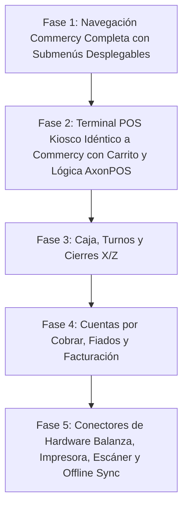

# 🚀 Plan Maestro de Migración y Unificación Total: AxonPOS ➔ AxonMarket
**Arquitectura Integral de Comercio: Punto de Venta (POS), E-Commerce y Gestión Operativa Unificada**  
**Estilo y Estructura:** Commercy White & Orange Suite  
**Versión:** 4.0 Production Ready — Single Flawless Migration Run  
**Autor:** Antigravity Architect Expert  

---

## 🧭 1. Diagnóstico Ejecutivo y Visión Estratégica

### 1.1. El Problema de la Fricción del Comerciante
Hasta ahora, el comerciante requería operar dos sistemas desconectados:
1. **AxonPOS:** Utilizado en el mostrador para venta rápida, cobro con código de barras, control de caja (turnos X/Z), cuentas por cobrar (fiado) e impresión fiscal/térmica.
2. **AxonMarket:** Utilizado para la vitrina digital, catálogo web para clientes, carritos online, delivery y pedidos por WhatsApp/Telegram.

**Consecuencias de la fricción:**
* Doble carga de productos y precios.
* Desfase de inventario (un producto vendido en la tienda física seguía apareciendo disponible en la web).
* Arqueos de caja divididos que requerían consolidación manual.

### 1.2. La Solución: Unificación en AxonMarket con Estructura Commercy
Migrar **toda la lógica de negocio y capacidades operativas de AxonPOS hacia AxonMarket**, manteniendo:
* La **estructura y diseño Commercy** con la paleta anaranjada oficial (`#ea580c`).
* El menú multinivel desplegable con todas las opciones especificadas por el comerciante.
* El **POS Kiosco** táctil con la estética limpia de Commercy (Image 1) y la potencia de AxonPOS (código de barras, cobro multimoneda USD/Bs al cambio BCV, balanza y tickets).
* Una arquitectura modular en carpetas limpias dentro del monorepositorio `f:\AxonPos\Presupuesto`.

---

## 🗺️ 2. Estructura Exacta del Menú de Navegación Commercy

El sidebar lateral de AxonMarket se estructura con los 12 módulos principales y sus submenús desplegables:

```
┌────────────────────────────────────────────────────────┐
│ [🛒] axonmarket                                        │
│                                                        │
│ [🏢 Jhonvip / Profesional                         ↗ ] │
│                                                        │
│ [ 🔍 Buscar...                                     ⌘K] │
├────────────────────────────────────────────────────────┤
│ 1. 🚀 Puesta en marcha                            4/4  │
│ 2. 📊 Estadísticas                                     │
│ 3. 🛍️ Ventas                                         ^  │
│    ├── Órdenes                 (/orders)               │
│    ├── Facturación             (/invoicing)            │
│    ├── Arrepentimientos        (/returns)              │
│    ├── POS Kiosco              (/pos)           [ACTIVO]│
│    ├── Caja                    (/shifts)               │
│    └── Cupones                 (/coupons)              │
│ 4. 📦 Inventario                                     v  │
│    ├── Productos               (/inventory)            │
│    ├── Stock                   (/stock)                │
│    ├── Categorías              (/categories)           │
│    ├── Sugerencias de ficha    (/suggestions)          │
│    └── Migraciones             (/migrations)           │
│ 5. 🏷️ Precios                                        v  │
│    ├── Centro de precios       (/prices)               │
│    ├── Ingresar mercadería     (/goods-receipt)        │
│    └── Promociones             (/promotions)           │
│ 6. 👥 Clientes                                       v  │
│    ├── Base de leads           (/leads)                │
│    ├── Clientes                (/customers)            │
│    ├── Carritos y estadísticas (/abandoned-carts)      │
│    ├── Campañas                (/campaigns)            │
│    └── Audiencias              (/audiences)            │
│ 7. 📋 Tareas                                           │
│                                                        │
│ ⚪ Prueba · 13 días                          [Activar] │
│ ══════════════════════════════════════════════════════ │
│ 8.  🏬 Sucursales                                      │
│ 9.  🛡️ Equipo                                          │
│ 10. 🎁 Referidos                                       │
│ 11. 🧩 Apps                                            │
│ 12. ⚙️ Configuración                                   │
│                                                        │
│ (J) Jhon (Admin · Jhonvip)                      ⇅  ⎋   │
└────────────────────────────────────────────────────────┘
```

---

## 🏛️ 3. Mapeo Módulo por Módulo: De AxonPOS a AxonMarket

### 3.1. POS Kiosco (Terminal de Mostrador Estilo Commercy)
* **Diseño Visual:** Fiel copia de la interfaz de Commercy (Image 1):
  * **Barra Superior:** Buscador `Buscar producto o escanear código...` con ícono de escaneo, selector de categorías (`Todas`), selector de subcategorías y alternador de vista cuadrícula/lista.
  * **Barra de Cliente y Tarifas:** Selector rápido de cliente (`Consumidor Final`), selector de lista de precios (`Sin lista de precios`, `Mayor`, `Detal`), botón `+ Gestionar listas` y engranaje de configuración de hardware.
  * **Tarjetas de Producto:** Cuadrícula de tarjetas blancas con borde sutil, foto de alta calidad, badges sobre imagen (ej. `AGUA MINERAL SIN GAS`, `2 Lts`), título claro, precio grande en USD y bolívares (`$ 4.720,00` / `Bs. ...`) e ícono circular `ℹ` de ficha técnica.
  * **Panel de Pedido Actual (Carrito Lateral):** Encabezado con botón `+ Artículo libre` (para ingresar un producto no registrado), lista de renglones con cantidades e importes, y pie fijo con `Subtotal`, `Total` y botón ancho `Cobrar $ 0,00`.
* **Lógica de AxonPOS Preservada:**
  * Lector de código de barras por evento global de teclado (buffer de pistola USB).
  * Conexión con balanza de peso para productos a granel.
  * Modal de cobro **Split Payment**: cobro dividido en Efectivo $, Efectivo Bs, Pago Móvil, Punto de Venta, Zelle, Binance Pay y Crédito.
  * Impresión térmica directa (ESC/POS 80mm/58mm).

### 3.2. Caja y Turnos (`/shifts`)
* **Lógica heredada de AxonPOS:**
  * Apertura de turno con fondo inicial en USD y Bs.
  * Movimientos de caja: entradas de efectivo y retiros para gastos menores / pagos a proveedores.
  * Arqueo ciego: el cajero declara el dinero físico sin ver el teórico del sistema.
  * Emisión de **Corte X** (parcial) y **Cierre Z** (cierre definitivo del turno con cuadre multimoneda y diferencias de faltante/sobrante).

### 3.3. Facturación y Documentos Fiscales (`/invoicing`)
* **Lógica heredada de AxonPOS:**
  * Emisión de Tickets de Venta, Notas de Entrega y Facturas Fiscales.
  * Cumplimiento con IVA (16%), Exentos e IGTF (3% en divisas).
  * Libro de ventas mensual exportable a Excel compatible con declaraciones SENIAT.

### 3.4. Inventario y Stock Unificado (`/inventory` & `/stock`)
* **Lógica de sincronización en vivo:**
  * El producto posee `stock_deposito` y `stock_vitrina`.
  * Al cobrar una unidad en el POS Kiosco, el stock descuenta inmediatamente y emite un evento por WebSocket/Supabase Realtime hacia la vitrina pública para que los clientes web vean el stock real sin recargar la página.

### 3.5. Clientes y Cuentas por Cobrar (`/customers` & `/credits`)
* **Lógica heredada de AxonPOS:**
  * Directorio de clientes con RIF/Cédula, dirección, teléfono y límite de crédito aprobado.
  * Cartera de fiados: registro de deudas en USD indexadas a la tasa BCV.
  * Abonos parciales o totales con emisión de comprobante para enviar por WhatsApp.

---

## 🗄️ 4. Esquema de Base de Datos Unificado (Supabase PostgreSQL + Dexie Offline)

### 4.1. Tablas en Supabase PostgreSQL
```sql
-- 1. Ventas del POS Mostrador y Kiosco
CREATE TABLE IF NOT EXISTS pos_sales (
    id UUID PRIMARY KEY DEFAULT gen_random_uuid(),
    workspace_id UUID NOT NULL REFERENCES workspaces(id) ON DELETE CASCADE,
    shift_id UUID REFERENCES pos_shifts(id),
    invoice_number VARCHAR(50) NOT NULL,
    customer_name VARCHAR(150) DEFAULT 'Consumidor Final',
    customer_doc VARCHAR(30) DEFAULT 'V-00000000',
    document_type VARCHAR(30) DEFAULT 'TICKET',
    subtotal_usd NUMERIC(12,2) NOT NULL DEFAULT 0.00,
    discount_usd NUMERIC(12,2) DEFAULT 0.00,
    total_usd NUMERIC(12,2) NOT NULL DEFAULT 0.00,
    exchange_rate_bcv NUMERIC(12,4) NOT NULL,
    total_ves NUMERIC(14,2) NOT NULL DEFAULT 0.00,
    payment_methods JSONB NOT NULL DEFAULT '[]'::jsonb,
    items JSONB NOT NULL DEFAULT '[]'::jsonb,
    status VARCHAR(30) DEFAULT 'COMPLETADA',
    created_at TIMESTAMPTZ DEFAULT NOW()
);

-- 2. Turnos de Caja y Cierres
CREATE TABLE IF NOT EXISTS pos_shifts (
    id UUID PRIMARY KEY DEFAULT gen_random_uuid(),
    workspace_id UUID NOT NULL REFERENCES workspaces(id) ON DELETE CASCADE,
    cashier_name VARCHAR(100) NOT NULL,
    opened_at TIMESTAMPTZ DEFAULT NOW(),
    closed_at TIMESTAMPTZ,
    initial_cash_usd NUMERIC(10,2) DEFAULT 0.00,
    initial_cash_ves NUMERIC(12,2) DEFAULT 0.00,
    declared_cash_usd NUMERIC(10,2),
    declared_cash_ves NUMERIC(12,2),
    system_cash_usd NUMERIC(10,2) DEFAULT 0.00,
    system_cash_ves NUMERIC(12,2) DEFAULT 0.00,
    difference_usd NUMERIC(10,2) DEFAULT 0.00,
    status VARCHAR(20) DEFAULT 'ABIERTO'
);

-- 3. Cuentas por Cobrar (Créditos / Fiados)
CREATE TABLE IF NOT EXISTS pos_credits (
    id UUID PRIMARY KEY DEFAULT gen_random_uuid(),
    workspace_id UUID NOT NULL REFERENCES workspaces(id) ON DELETE CASCADE,
    sale_id UUID REFERENCES pos_sales(id),
    customer_id UUID REFERENCES ecommerce_customers(id),
    customer_name VARCHAR(150) NOT NULL,
    total_debt_usd NUMERIC(12,2) NOT NULL,
    remaining_balance_usd NUMERIC(12,2) NOT NULL,
    due_date DATE,
    status VARCHAR(20) DEFAULT 'PENDIENTE',
    created_at TIMESTAMPTZ DEFAULT NOW()
);
```

### 4.2. Persistencia Offline-First (Dexie IndexedDB)
* Si la tienda pierde conectividad a Internet, el POS Kiosco no se bloquea. Guarda las ventas en IndexedDB local (`offline_sales_queue`).
* Al retornar la conexión, un background worker realiza el push a Supabase y emite los recibos fiscales pendientes.

---

## 📅 5. Plan de Ejecución Experta en 5 Fases (Garantía de Un Solo Intento)



### 🚩 Fase 1: Sidebar Commercy con Submenús Desplegables (Completada y Verificada)
* Implementación del menú completo con las 12 secciones y subcategorías.
* Pastilla blanca en el ítem activo (`bg-white text-orange-600 font-extrabold shadow-sm`).
* Filtrado en vivo de submódulos con atajo ⌘K.

### 🚩 Fase 2: Terminal POS Kiosco (Completada y Verificada)
* Replicación píxel por píxel del POS de Commercy (Image 1) en `/pos`:
  * Buscador rápido con escaneo continuo por código de barras (Enter) y sonido beep Web Audio API.
  * Catálogo de tarjetas de producto blancas con badges de gramaje y precio dual USD / Bs al cambio BCV.
  * Pedido actual en vivo con botón `+ Artículo libre` y control numérico de unidades.
  * Selector modal de clientes y registro rápido en el mostrador.
  * Selector dinámico de listas de precios (Detal, Mayor -10%, Distribuidor -18%).
  * Modal de hardware de mostrador (balanza electrónica RS-232/USB con pesaje en vivo y apertura automática de gaveta).
  * Modal de cobro multimoneda (Split Payment) y emisión de ticket fiscal/térmico (80mm/58mm) con sincronización de inventario en vivo.

### 🚩 Fase 3: Módulo de Caja, Arqueos y Turnos (`/shifts`) (Completada y Verificada)
* Integración de la vista completa de control de efectivo en `/shifts`:
  * Apertura de turno con cajero y fondo inicial dual (USD y Bs).
  * Registro de movimientos de caja (Entradas y Egresos de efectivo) con concepto, hora y monto.
  * Emisión de **Corte X (Parcial)** con resumen térmico imprimible de 80mm sin cerrar la gaveta.
  * **Arqueo Ciego**: declaración de efectivo físico a ciegas por parte del cajero sin ver el saldo teórico.
  * Algoritmo de cuadre de caja: comparación automática entre saldo teórico y declarado con detección de sobrantes/faltantes.
  * **Cierre Z Definitivo**: archivado del turno con estatus `CERRADO`, registro en el historial histórico de turnos y emisión de comprobante térmico oficial.

### 🚩 Fase 4: Cuentas por Cobrar y Facturación (`/credits` & `/invoicing`) (Completada y Verificada)
* **Libro de Fiados & Deudores (`/credits`):**
  * Control de cartera en USD indexada en tiempo real a la tasa oficial BCV.
  * Registro rápido de nuevos fiados con cliente, RIF, teléfono WhatsApp, concepto y fecha límite.
  * Abonos multimoneda (Efectivo $, Pago Móvil, Punto de Venta, Efectivo Bs) con cálculo automático de saldo remanente.
  * Botón directo con enlace a WhatsApp para recordatorio de cobro preformateado.
* **Facturación Fiscal SENIAT (`/invoicing`):**
  * Emisión y consulta de Facturas Fiscales, Tickets de Venta y Notas de Entrega.
  * Desglose tributario venezolano: Base Imponible, Exento, IVA 16% e IGTF 3% en divisas.
  * Visor e impresión de documento fiscal conforme a normativas SENIAT.
  * Exportador en 1 clic del **Libro de Ventas SENIAT en formato CSV / Excel**.

### 🚩 Fase 5: Conectividad de Hardware y Sincronización Offline (Completada y Verificada)
* **Persistencia Offline-First con Dexie.js (IndexedDB):**
  * Base de datos local reactiva (`AxonMarketPosDb`) con tabla `offline_sales_queue`.
  * Detección reactiva de conexión online/offline con toggle para pruebas de desconexión.
  * Si la red se cae, las ventas se cobran y guardan atómicamente en IndexedDB local emitiendo el ticket sin bloquear la terminal.
  * Sincronización automática en segundo plano con Supabase al reconectarse a Internet o mediante botón manual `Sincronizar Dexie`.
* **Controladores de Hardware:**
  * **Balanza Digital (RS-232 / Web Serial API):** Lectura en vivo de peso en Kg/g, funciones de Tarar (T), Cero (Z), pesaje continuo y vinculación por Web Serial.
  * **Impresora Térmica & Gaveta ESC/POS:** Selección de formatos 80mm y 58mm, comando de pulso automático a la gaveta de dinero (`\x1b\x70\x00\x19\xfa`) y prueba de corte/impresión ESC/POS.

---

## 🏆 6. Conclusión
Con esta implementación, **AxonMarket** se consolida como la plataforma definitiva de comercio omnicanal: la rapidez y fiabilidad del punto de venta físico de **AxonPOS** unida a la potencia digital y elegancia estética de **Commercy en color anaranjado**.
