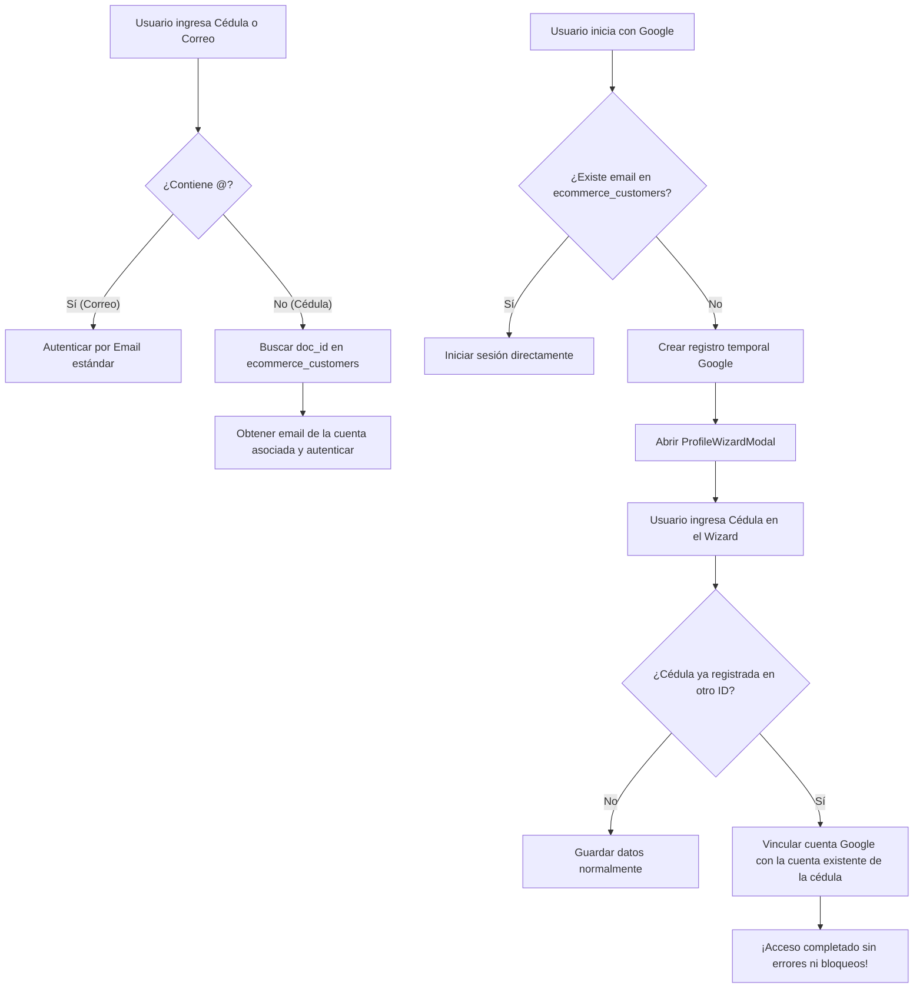

# 🔐 Plan de Resolución Integral: Autenticación, Wizard de Perfil y Unificación Visual en AxonMarket

---

## 1. 🔍 Diagnóstico Técnico y Causa Raíz del Problema

### A. ¿Por qué ocurre la alerta *"Esa cédula/documento ya está registrada en otra cuenta"*?
1. **Inicio de sesión con Google (`handleGoogleSuccess`)**:
   - Cuando el usuario pulsa **"Continuar con Google"** (`basededatosbull@gmail.com`), el sistema busca en la tabla `ecommerce_customers` coincidencia por correo (`.ilike('email', cleanEmail)`).
   - Si no existe un cliente con ese correo exacto (por ejemplo, porque el usuario se registró originalmente con otro email o con solo su Cédula/teléfono en el POS), el sistema crea un nuevo registro con:
     ```javascript
     {
       id: 'CUS-xxxxxx',
       email: 'basededatosbull@gmail.com',
       phone: '',
       doc_id: '',
       address: ''
     }
     ```
   - Al faltar el teléfono y la cédula (`cleanDoc.length < 6`), el sistema marca:
     ```javascript
     const isProfileIncomplete = isNewUser || !mappedUser.address || cleanPhone.length < 11 || cleanDoc.length < 6;
     if (isProfileIncomplete) setIsWizardOpen(true);
     ```
   - Esto fuerza la apertura obligatoria del modal **"Completa tu Perfil"** (`ProfileWizardModal`).

2. **Bloqueo en el Wizard (`ProfileWizardModal.jsx`)**:
   - En el paso final del asistente, el usuario sube su foto y envía el formulario.
   - La lógica ejecuta:
     ```javascript
     const currentDoc = activeCustomer?.doc_id || activeCustomer?.docId;
     if (formData.docId && formData.docId !== currentDoc) {
       const { data } = await supabase
         .from('ecommerce_customers')
         .select('id')
         .eq('doc_id', formData.docId.trim())
         .neq('id', targetId)
         .maybeSingle();
       if (data) {
         alert('Esa cédula/documento ya está registrada en otra cuenta.');
         setIsSubmitting(false);
         return;
       }
     }
     ```
   - Si la cédula del usuario (`36430689`) ya existía en otro registro de la base de datos (por ejemplo, de una cuenta previa creada manualmente o sincronizada con el POS), el asistente **frena la ejecución con un `alert` sin permitir avanzar ni unificar las cuentas**, dejando al usuario atrapado en un bucle infinito cada vez que entra con Google.

3. **Incompatibilidad del Login Manual**:
   - En el formulario de inicio de sesión de clientes, el campo solicitaba exclusivamente `type="email"` con etiqueta fija *"CORREO ELECTRÓNICO"*.
   - Los usuarios en Venezuela suelen autenticarse directamente con su **Cédula de Identidad** (ej: `36430689`), lo cual provocaba que el intento fallara o forzaba al usuario a usar el botón de Google, cayendo en el bloqueo descrito.

4. **Bloqueo por Nombre Duplicado**:
   - Existía una restricción que impedía guardar un nombre si ya existía en otro registro (`.ilike('name', formData.name.trim())`), lo cual es incorrecto ya que dos personas pueden llamarse igual.

---

### B. ¿Por qué el modal de inicio de sesión de cliente se veía diferente al de comerciantes?
1. **Diferencias Estéticas Significativas**:
   - **Modal de Comerciantes (`isMerchantModalOpen`)**:
     - Barra de acento superior con degradado ámbar (`bg-gradient-to-r from-amber-400 to-amber-600`).
     - Contenedor flotante con esquinas redondeadas prémium (`rounded-[3rem] border border-slate-200 shadow-2xl`).
     - Cabecera con selector de pestañas estilo píldora (`bg-slate-100 rounded-full p-1 border border-slate-200`).
     - Icono distintivo dentro de un contenedor cuadrado suave con bordes redondeados (`w-12 h-12 bg-amber-50 rounded-2xl text-amber-500`).
     - Campos de entrada con fondo slate suave (`bg-slate-50 border-slate-200 focus:bg-white text-slate-900 font-medium placeholder-slate-400 shadow-sm`).
     - Botón principal de acción en color ámbar con sombras doradas sutiles (`shadow-lg shadow-amber-500/20 hover:bg-amber-400 text-slate-950 font-bold`).
   - **Modal de Clientes (`isAuthModalOpen`)**:
     - Utilizaba estilos antiguos tipo fondo blanco puro (`bg-white`), bordes `border-zinc-200`, fuentes `font-light`, un icono circular genérico sin profundidad, y carecía de la barra superior degradada y de la botonera píldora de alternancia de pestañas.

---

## 2. 🎯 Objetivos de la Solución

1. **Unificación de Diseño Frontend (Cliente = Comerciante)**:
   - Rediseñar el modal de inicio de sesión de cliente en [MarketplaceDirectory.jsx](file:///f:/AxonPos/Presupuesto/src/modules/ecommerce/pages/MarketplaceDirectory.jsx) y [PublicStore.jsx](file:///f:/AxonPos/Presupuesto/src/modules/ecommerce/pages/PublicStore.jsx) para que adopte la misma estética institucional, tipografías, pestañas tipo píldora, barra superior degradada y campos estilizados del modal de comerciante.

2. **Acceso Dual: Correo Electrónico o Cédula**:
   - Permitir ingresar indistintamente con `usuario@correo.com` o con Cédula/RIF (ej. `36430689` o `V-36430689`).
   - Si el usuario introduce una cédula en el login, el sistema resolverá automáticamente el registro del cliente correspondiente para validar sus credenciales.

3. **Vinculación Inteligente de Cuentas (Account Linking)**:
   - En el `ProfileWizardModal`, si la cédula ingresada ya existe en otro registro:
     - Ofrecer la **vinculación automática inmediata** de la sesión de Google con dicho perfil existente, fusionando la foto y correo de Google en la cuenta real sin mostrar alertas hostiles.
   - Si no hay colisión, guardar normalmente.
   - Eliminar la validación restrictiva de nombre duplicado.

---

## 3. 🛠️ Plan de Implementación Paso a Paso



### Fase 1: Rediseño Visual del Modal de Clientes (Estilo Comerciante)
- Implementar la barra degradada superior:
  `<div className="absolute top-0 left-0 w-full h-1.5 bg-gradient-to-r from-amber-400 to-amber-600"></div>`
- Implementar el header con icono institucional en badge `bg-amber-50 rounded-2xl border-amber-200/60 text-amber-500`.
- Añadir el selector de pestañas píldora:
  - **Iniciar Sesión** | **Crear Cuenta**
- Estilizar inputs con `bg-slate-50 border border-slate-200 rounded-2xl px-5 py-4 text-slate-900 focus:border-amber-500 focus:bg-white`.
- Estilizar botón de envío con `bg-amber-500 text-slate-950 font-bold uppercase tracking-[0.2em] shadow-lg shadow-amber-500/20`.

### Fase 2: Soporte para Login con Cédula o Correo
- Cambiar el campo de autenticación a `type="text"`.
- Etiqueta: `CORREO ELECTRÓNICO O CÉDULA / RIF`.
- Placeholder: `tu@correo.com o V-12345678`.
- En `handleLogin`:
  - Si el identificador no tiene `@`, limpiar caracteres no numéricos y buscar en `ecommerce_customers` donde `doc_id` coincida con la cédula limpia o con prefijo.
  - Al encontrar la cuenta, autenticar contra Supabase con el email registrado de esa cuenta.

### Fase 3: Resolución de Cédula y Vinculación en `ProfileWizardModal.jsx`
- Reemplazar el `alert('Esa cédula/documento ya está registrada en otra cuenta.')` por una rutina de vinculación:
  - Si el documento ya existe en otro registro `existingAcc`:
    - Preguntar o fusionar automáticamente: actualizar el registro existente con los datos de Google (`email`, `profile_pic`, `is_verified: true`, `auth_provider: 'google'`), y eliminar el registro temporal duplicado generado por Google OAuth.
    - Establecer la sesión activa sobre la cuenta unificada.
- Eliminar la validación bloqueante de nombres iguales.

### Fase 4: Verificación, Build y Despliegue
- Ejecutar `npx vite build` en `f:\AxonPos\Presupuesto`.
- Probar flujos de login y registro.
- Sincronizar y desplegar mediante `actualizar.bat` a Cloudflare Pages y GitHub.
