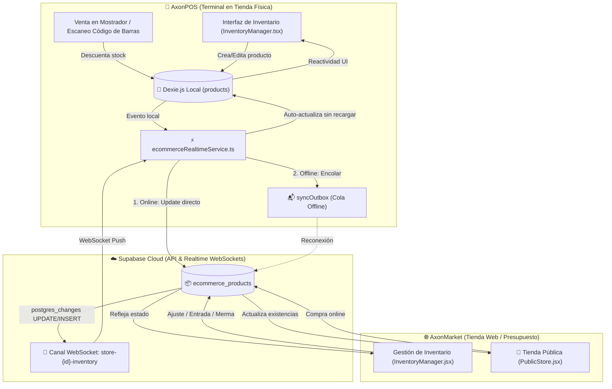

# 📦 PLAN DE IMPLEMENTACIÓN: UNIFICACIÓN DE INVENTARIO CENTRALIZADO (AXONPOS ↔ AXONMARKET)

> **Documento Oficial de Arquitectura y Guía Técnica de Unificación**  
> **Ubicación Principal**: `docs/PLAN_UNIFICACION_INVENTARIO_AXONPOS_AXONMARKET.md`  
> **Ubicación en E-commerce**: `Presupuesto/docs/modules/unificacion_inventario.md`  
> **Sistemas Involucrados**:  
> - **AxonPOS**: Sistema de Punto de Venta de Escritorio / Local (`f:/AxonPos/src`)  
> - **AxonMarket**: Tienda Virtual y Panel Web del Comerciante (`f:/AxonPos/Presupuesto`)  
> - **Supabase Cloud**: Capa de Persistencia y Señalización en Tiempo Real (`ecommerce_products`, `workspaces`)  
> **Fecha**: Octubre 2026  
> **Estado**: Listo para Ejecución  

---

## 🎯 1. OBJETIVO ESTRATÉGICO

Eliminar la discrepancia existente entre el inventario del Punto de Venta físico (**AxonPOS**) y el inventario de la Tienda Virtual (**AxonMarket**), consolidando una **arquitectura de Inventario Único y Coherente**.

Cualquier cambio de stock, precio, costo (COGS), categoría, merma, auditoría o transferencia realizado en **AxonPOS** debe reflejarse inmediatamente en **AxonMarket**, y viceversa, garantizando la paridad funcional 1:1 en ambos entornos sin peligro de sobreventa ni desfase contable.

---

## 🔍 2. DIAGNÓSTICO: ¿POR QUÉ ESTABAN DESCONECTADOS?

Al examinar a profundidad ambas bases de código se identificaron los siguientes puntos de quiebre:

```
┌─────────────────────────────────────────────────────────────────────────────────────────────┐
│                                   ESTADO ACTUAL (DESCONECTADO)                              │
├──────────────────────────────────────────────┬──────────────────────────────────────────────┤
│               AxonPOS (Caja Física)          │            AxonMarket (Tienda Virtual)       │
├──────────────────────────────────────────────┼──────────────────────────────────────────────┤
│ 1. Almacenamiento: Dexie.js (IndexedDB local)│ 1. Almacenamiento: Supabase PostgreSQL       │
│    en tabla `products`.                      │    en tabla `ecommerce_products`.           │
│                                              │                                              │
│ 2. Actualización de Stock (onUpdateStock):   │ 2. Actualización de Stock:                   │
│    Solo ejecuta `db.products.update()`.      │    Ejecuta `supabase.from(...).update()`.    │
│    ❌ No emite cambio a Supabase.            │    ❌ AxonPOS no está suscrito a esta tabla. │
│                                              │                                              │
│ 3. Guardado de Producto (onSaveProduct):     │ 3. Creación de Producto (InventoryManager):  │
│    Solo ejecuta `db.products.put(p)`.        │    Guarda en `ecommerce_products` con campos │
│    ❌ Requiere sincronización manual.        │    propios (`cogs`, `stock_vitrina`).        │
│                                              │                                              │
│ 4. Funciones de Inventario:                  │ 4. Funciones de Inventario:                  │
│    Maneja `currentStock` plano, sin división │    Maneja `stock` (Depósito) y `stockVitrina`│
│    de stock de vitrina vs bodega.            │    (Vitrina), mermas directas y auditoría.   │
└──────────────────────────────────────────────┴──────────────────────────────────────────────┘
```

### Consecuencias Críticas de la Desconexión:
1. **Riesgo de Sobreventa:** Un producto vendido físicamente en la caja de AxonPOS no descontaba de inmediato en la vitrina web de AxonMarket, permitiendo que un cliente online compre mercancía inexistente.
2. **Doble Trabajo para el Comerciante:** Cargar o ajustar inventario obligaba a hacerlo dos veces (en la máquina del negocio y en la plataforma web).
3. **Pérdida de Trazabilidad Contable:** Los costos (COGS) y precios calculados en la web no alimentaban los libros de venta locales del POS.

---

## 🏛️ 3. ARQUITECTURA DE LA SOLUCIÓN: INVENTARIO ÚNICO (SINGLE SOURCE OF TRUTH)

La solución adopta el patrón **Edge-Compute con Reconciliación en Tiempo Real**:
- **Caja Local (AxonPOS):** Mantiene respuesta instantánea (< 5 ms) mediante Dexie.js para operar sin interrupciones incluso si se corta internet.
- **Nube Central (Supabase):** Actúa como bus central de eventos WebSocket y catálogo oficial compartido de la tienda virtual.
- **Sincronización Bidireccional Automática:** Cada terminal conectada escucha y publica cambios en milisegundos.



---

## 🧩 4. MATRIZ DE HOMOLOGACIÓN Y PARIDAD FUNCIONAL 1:1

Para que ambos sistemas tengan las mismas capacidades, homologamos los modelos y las funcionalidades:

| Característica / Función | Implementación en AxonPOS | Implementación en AxonMarket | Protocolo de Sincronización |
| :--- | :--- | :--- | :--- |
| **Identificador Único** | `Product.id` (UUID o SKU) | `ecommerce_products.id` | Clave primaria compartida 1:1. |
| **Stock en Depósito (Bodega)** | `Product.stockWarehouse` | `ecommerce_products.stock` | Si cambia en uno, se propaga al otro en tiempo real. |
| **Stock en Vitrina (Mostrador)** | `Product.stockVitrina` | `ecommerce_products.stock_vitrina` | Sincronizado; la venta en mostrador descuenta `stockVitrina`. |
| **Stock Total Disponible** | `currentStock = stockWarehouse + stockVitrina` | Suma de `stock + stock_vitrina` | Calculado y validado en ambos módulos. |
| **Costo (COGS) y Margen** | `Product.costUsd` | `ecommerce_products.cogs` | Cálculo de margen: `((precio - costo) / precio) * 100`. |
| **Punto Mínimo (Reorden)** | `Product.minStock` | `ecommerce_products.min_stock` | Alerta de reabastecimiento generable en ambos. |
| **Stock Máximo (Sobre-Stock)**| `Product.maxStock` | `ecommerce_products.max_stock` | Alerta de capital congelado y sobre-almacenamiento. |
| **Control de Vencimiento** | `Product.expirationDate` | `ecommerce_products.expiration_date` | Alerta `"Vence Pronto"` (<= 3 días) visible en ambos. |
| **Categorías y Subcategorías**| `categoryId` y `subcategoryId` | `category` y `subcategory` | Resolución automática ID ↔ Nombre en sincronización. |
| **Registro de Mermas (Waste)**| Modal de Merma en POS con motivo | Modal de Merma en Web con motivo | Descuento de stock + registro en `inventoryLogs`. |
| **Auditoría / Conteo Físico** | Modal de Conteo Ciego | Modal de Auditoría | Ajuste de inventario con motivo `"AUDIT"`. |
| **Transferencias (Depósito ↔ Vitrina)** | Botón Transferir en fila | Botón Transferir en fila | Ajuste interno de `stock` vs `stockVitrina`. |
| **Combos Promocionales** | Kit retail que descuenta componentes | Kits promocionales vinculados | Soporte de componente `comboItems`. |
| **Publicación en Vitrina Web**| Checkbox `"Publicar en Tienda Web"` | Toggle `"En Vitrina / Oculto"` | Campo `publish_status: 'Publicado' \| 'Borrador'`. |

---

## 🗄️ 5. MAPEO DE CAMPOS (DEXIE ↔ SUPABASE)

```typescript
// Mapeo canónico de transformación bidireccional
export function mapProductToSupabase(p: Product, workspaceId: string, categoryName: string, subcategoryName?: string) {
  return {
    id: p.id,
    workspace_id: workspaceId,
    name: p.name,
    price: Number(p.priceUsd || 0),
    cogs: Number(p.costUsd || 0),
    stock: Number(p.stockWarehouse ?? p.currentStock ?? 0),
    stock_vitrina: Number(p.stockVitrina ?? 0),
    min_stock: Number(p.minStock || 5),
    max_stock: p.maxStock ? Number(p.maxStock) : null,
    supplier: p.supplier || p.brand || '',
    category: categoryName || 'General',
    subcategory: subcategoryName || '',
    expiration_date: p.expirationDate || null,
    publish_status: p.syncedEcommerce !== false && p.isActive !== false ? 'Publicado' : 'Borrador',
    image_url: p.imageUrl || p.localImageData || null,
    unit_type: p.unit === 'kg' ? 'kg' : 'unidad',
    created_at: p.updatedAt || new Date().toISOString()
  };
}

export function mapSupabaseToProduct(raw: any, existingProduct?: Product): Product {
  const stockWarehouse = Number(raw.stock || 0);
  const stockVitrina = Number(raw.stock_vitrina || 0);
  const totalStock = stockWarehouse + stockVitrina;

  return {
    id: raw.id,
    sku: raw.id,
    barcode: existingProduct?.barcode || raw.batch_number || raw.id,
    name: raw.name,
    description: existingProduct?.description || '',
    categoryId: existingProduct?.categoryId,
    subcategoryId: existingProduct?.subcategoryId,
    priceUsd: Number(raw.price || 0),
    costUsd: Number(raw.cogs || 0),
    taxType: existingProduct?.taxType || 'GENERAL',
    currentStock: totalStock,
    stockWarehouse: stockWarehouse,
    stockVitrina: stockVitrina,
    minStock: Number(raw.min_stock || 5),
    maxStock: raw.max_stock ? Number(raw.max_stock) : undefined,
    expirationDate: raw.expiration_date || undefined,
    supplier: raw.supplier || '',
    brand: raw.supplier || existingProduct?.brand || '',
    trackInventory: true,
    unit: raw.unit_type === 'kg' ? 'kg' : 'unit',
    isWeighted: raw.unit_type === 'kg',
    isDish: existingProduct?.isDish || false,
    kitchenDestination: existingProduct?.kitchenDestination || 'NONE',
    imageUrl: raw.image_url || existingProduct?.imageUrl,
    isActive: true,
    syncedEcommerce: raw.publish_status === 'Publicado',
    updatedAt: new Date().toISOString()
  };
}
```

---

## 📋 6. PLAN DE ACCIÓN PASO A PASO (GUÍA DE IMPLEMENTACIÓN)

### Paso 1: Extender la interfaz `Product` en AxonPOS (✅ COMPLETADO)
En [`f:/AxonPos/src/types/index.ts`](file:///f:/AxonPos/src/types/index.ts):
- Añadir campos de paridad:
  ```typescript
  export interface Product {
    // ... campos existentes
    stockWarehouse?: number;     // Stock en depósito / bodega
    stockVitrina?: number;       // Stock en vitrina / mostrador
    maxStock?: number;           // Stock máximo (alerta sobre-stock)
    expirationDate?: string;     // Fecha de vencimiento YYYY-MM-DD
    supplier?: string;           // Proveedor principal
    isCombo?: boolean;           // Indicador de kit promocional retail
    comboItems?: Array<{ id: string; qty: number }>;
  }
  ```
- En [`f:/AxonPos/src/db/database.ts`](file:///f:/AxonPos/src/db/database.ts): Se aplicó la `version(11)` indexando `supplier`, `expirationDate` y `syncedEcommerce`.
- En [`f:/AxonPos/src/services/ecommerceRealtimeService.ts`](file:///f:/AxonPos/src/services/ecommerceRealtimeService.ts): Implementadas funciones canónicas de transformación `mapProductToCloud` y `mapCloudToProduct`.

### Paso 2: Escucha en Tiempo Real de Inventario en AxonPOS (✅ COMPLETADO)
En [`f:/AxonPos/src/services/ecommerceRealtimeService.ts`](file:///f:/AxonPos/src/services/ecommerceRealtimeService.ts) y [`f:/AxonPos/src/App.tsx`](file:///f:/AxonPos/src/App.tsx):
- En el método `startListening()`, suscripción activa al canal WebSocket de Supabase en la tabla `ecommerce_products`:
  ```typescript
  .on(
    'postgres_changes',
    {
      event: '*', // INSERT, UPDATE, DELETE
      schema: 'public',
      table: 'ecommerce_products',
      filter: `workspace_id=eq.${storeId}`
    },
    async (payload) => {
      console.log('[AxonPOS Realtime] Evento de inventario recibido desde AxonMarket:', payload.eventType, payload.new);
      await this.handleCloudInventoryChange(payload);
    }
  )
  ```
- `handleCloudInventoryChange(payload)` implementado y enriquecido con:
  - **Resolución dinámica de categorías y subcategorías:** Si un producto llega desde la web con una categoría no registrada, se crea automáticamente en Dexie `db.categories`.
  - **Cálculo de existencias:** Suma canónica `currentStock = stockWarehouse + stockVitrina`.
  - **Filtro contra bucles infinitos:** Omite escrituras redundantes si los datos ya son idénticos.
  - **Trazabilidad en Kardex:** Genera registro en `db.inventoryLogs` con motivo `"Sincronizado desde AxonMarket"`.
  - **Notificaciones:** Emite chime sonoro `soundService.playSuccessChime()` y desktop push si está habilitado.
- En [`f:/AxonPos/src/App.tsx`](file:///f:/AxonPos/src/App.tsx): Suscripción a `subscribeInventory` con un Toast flotante animado de alta estética que alerta al cajero en vivo.
- En [`f:/AxonPos/src/components/TopHeader.tsx`](file:///f:/AxonPos/src/components/TopHeader.tsx): Indicador verde en vivo `🟢` de canal WebSocket de inventario activo.

### Paso 3: Disparadores Automáticos al Modificar en AxonPOS (✅ COMPLETADO)
En [`f:/AxonPos/src/App.tsx`](file:///f:/AxonPos/src/App.tsx) y [`f:/AxonPos/src/services/ecommerceRealtimeService.ts`](file:///f:/AxonPos/src/services/ecommerceRealtimeService.ts):
- **Actualización de Existencias (`onUpdateStock`)**:
  - Al ajustar inventario en cualquier módulo de AxonPOS, se actualiza `currentStock` y `stockWarehouse` en Dexie local, se asienta en Kardex y se emite inmediatamente:
    ```typescript
    ecommerceRealtimeService.syncStockToAxonMarket(
      settings.storeId,
      productId,
      prod.name,
      newStock,
      newWarehouse,
      currentVitrina
    );
    ```
- **Publicación de Productos (`onSaveProduct`)**:
  - Al crear o modificar un producto en `InventoryManager`, `HardwareWorkspace` o `AutoPartsWorkspace`, se guarda localmente en Dexie y se dispara la publicación en segundo plano a Supabase:
    ```typescript
    ecommerceRealtimeService.publishProductToAxonMarket(settings.storeId, p, categoryName, subcategoryName);
    ```
- **Reasignación Masiva de Categorías (`onBatchReassignCategory`)**:
  - Al mover artículos entre categorías o subcategorías, se actualiza Dexie y se sincroniza automáticamente con AxonMarket.
- **Descuento en Ventas Físicas de Caja Mostrador (`handleProcessPayment`)**:
  - Al cobrar una venta en el POS, el stock se descuenta de `stockVitrina` y `stockWarehouse` en Dexie y se ejecuta `ecommerceRealtimeService.syncCloudInventoryDeduction(settings.storeId, itemsToDeduct)` para reflejar el descuento en AxonMarket en tiempo real sin sobre-conteo.
- **Aceptación y Despacho de Pedidos Online (`onAcceptOrder` y Kanban)**:
  - Al pasar pedidos de `PENDING` a estados operativos, se descuenta de forma segura el stock local y se valida contra la nube.

### Paso 4: Homologar las Funciones de Inventario en la UI de AxonPOS (✅ COMPLETADO)
En [`f:/AxonPos/src/components/InventoryManager.tsx`](file:///f:/AxonPos/src/components/InventoryManager.tsx):
- **4 Tarjetas KPI Ejecutivas en Cabecera**:
  - `Capital Invertido (COGS)`: Suma de costo x stock en tiempo real con contador de productos.
  - `Venta Proyectada (PVP)`: Ingreso estimado en USD y contravalor en Bs. tasa BCV.
  - `Ganancia Potencial`: Margen bruto proyectado y porcentaje de rentabilidad general.
  - `Ubicación & Alertas`: Desglose total de unidades en Vitrina vs Bodega con contadores de bajo stock y productos por vencer.
- **Columna de Existencia Dual en Tabla**:
  - Indicador numérico principal con tags de desglose: `🏪 Vitrina: X` y `📦 Bodega: Y`.
  - Badges de alerta de estado: `Sobre-Stock` (si supera `maxStock`), `Bajo Stock`, `Agotado`, y fecha de expiración.
- **Toggle Interactivo E-commerce en Fila**:
  - Botón de 1 clic para publicar u ocultar el producto en la vitrina web (`<Eye size={12} /> En Vitrina Web` / `<EyeOff size={12} /> Oculto`) con sincronización inmediata con Supabase.
- **3 Modales Operativos Homologados con AxonMarket**:
  - **Modal de Transferencia Interna (`isTransferModalOpen`)**: Mueve existencias entre `Bodega ➔ Vitrina` o `Vitrina ➔ Bodega`, asienta el movimiento en Kardex Dexie y envía auto-push a Supabase.
  - **Modal de Merma / Descarte (`isWasteModalOpen`)**: Registra salidas por vencimiento, daño o uso interno, especificando si la baja es de Vitrina o Bodega con trazabilidad en Kardex y nube.
  - **Modal de Auditoría Física (`isAuditModalOpen`)**: Conteo ciego físico con cálculo de discrepancia en vivo (+/-) y ajuste automático.
- **Formulario de Creación / Edición de Producto**:
  - Inputs duales para `Stock en Bodega` y `Stock en Vitrina` con cálculo automático en vivo de `Total en Sistema`.
  - Campos avanzados de inventario: `Stock Mínimo`, `Stock Máximo` (sobre-stock), `Proveedor Principal`, y `Fecha de Vencimiento`.

### Paso 5: Sincronización al Registrar Ventas en Caja (✅ COMPLETADO)
- Implementado en `src/App.tsx` (`handleProcessPayment`):
  - Prioriza el descuento de existencias de `stockVitrina` primero y luego de `stockWarehouse` para mantener coherencia en piso de venta.
  - Dispara `ecommerceRealtimeService.syncCloudInventoryDeduction(settings.storeId, saleItems)`.
  - Actualiza `ecommerce_products` en Supabase en el mismo segundo de cobro.

### Paso 6: Sincronización al Aceptar Pedidos en Tienda Web (✅ COMPLETADO)
- Implementado en `src/App.tsx` (`onAcceptOrder` y Kanban):
  - Al procesar órdenes de la web, se descuenta de forma segura el stock local sin duplicar deducciones y se sincroniza con Kardex local.

---

## 🧪 7. PROTOCOLO DE VALIDACIÓN Y PRUEBAS

```
┌────┬──────────────────────────────────────┬────────────────────────────────────────────────────────┐
│ #  │ Escenario de Prueba                  │ Resultado Esperado                                     │
├────┼──────────────────────────────────────┼────────────────────────────────────────────────────────┤
│ 1  │ Modificar stock en AxonPOS (Caja)    │ En menos de 1 segundo, AxonMarket muestra el nuevo     │
│    │                                      │ stock en su panel y en el catálogo web público.        │
├────┼──────────────────────────────────────┼────────────────────────────────────────────────────────┤
│ 2  │ Registrar entrada en AxonMarket      │ AxonPOS recibe el evento WebSocket e incrementa el     │
│    │ (`InventoryManager.jsx`)             │ stock en Dexie sin recargar la pantalla.               │
├────┼──────────────────────────────────────┼────────────────────────────────────────────────────────┤
│ 3  │ Venta en mostrador físico POS        │ El stock en la nube se descuenta instantáneamente; la   │
│    │                                      │ tienda virtual actualiza su vitrina en tiempo real.    │
├────┼──────────────────────────────────────┼────────────────────────────────────────────────────────┤
│ 4  │ Compra online en AxonMarket          │ Al despacharse o aceptarse en POS, el stock local se   │
│    │                                      │ descuenta y se genera registro en el Kardex.          │
├────┼──────────────────────────────────────┼────────────────────────────────────────────────────────┤
│ 5  │ Venta en POS sin conexión a internet │ Se registra en `syncOutbox`. Al recuperar conexión,   │
│    │                                      │ se vacía la cola y sincroniza con Supabase.            │
└────┴──────────────────────────────────────┴────────────────────────────────────────────────────────┘
```

---

## 📌 8. CONCLUSIÓN Y BENEFICIOS DIRECTOS

Con la ejecución de este plan, el ecosistema **Axon** alcanzará una coherencia total:
1. **Un solo inventario vivo**: Se acaba la duplicidad de catálogos y stocks divergentes.
2. **Cero sobreventa**: Todo lo que se vende en mostrador se descuenta en la web, y viceversa.
3. **Mismas funciones para el comerciante**: Mermas, auditorías, transferencias bodega-vitrina y costos sincronizados en ambas plataformas.
4. **Independencia operativa**: AxonPOS sigue siendo ultra veloz y tolerante a fallas de internet gracias a Dexie.js, mientras AxonMarket ofrece toda la potencia de la nube en Supabase.
